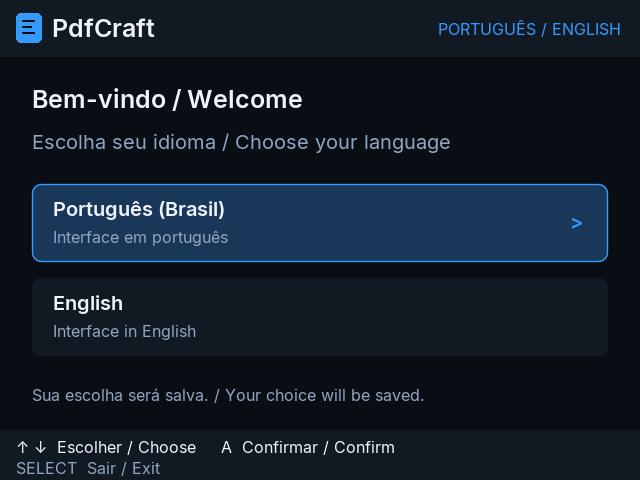
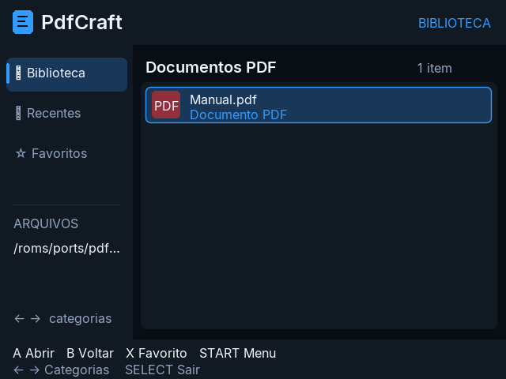
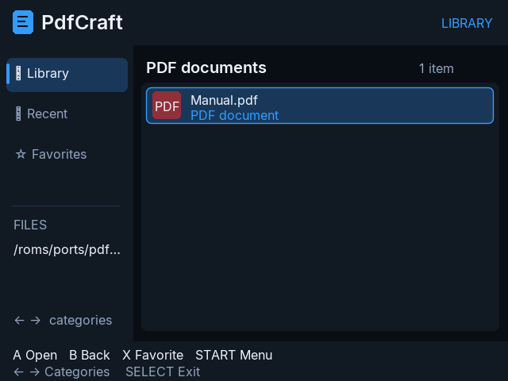
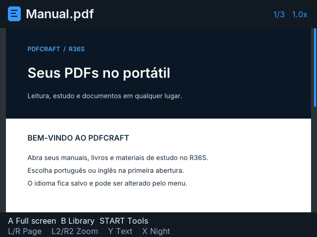
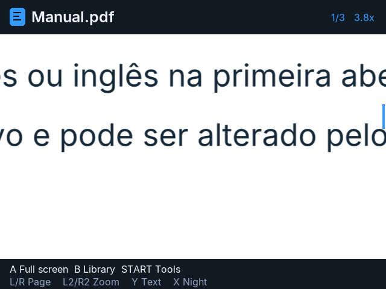
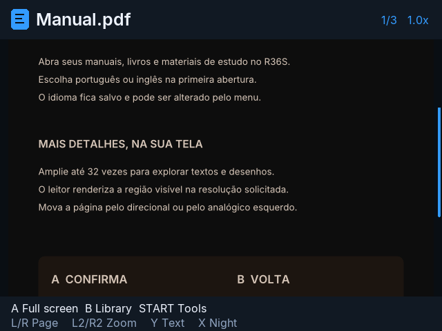
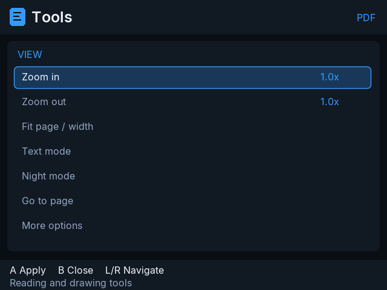
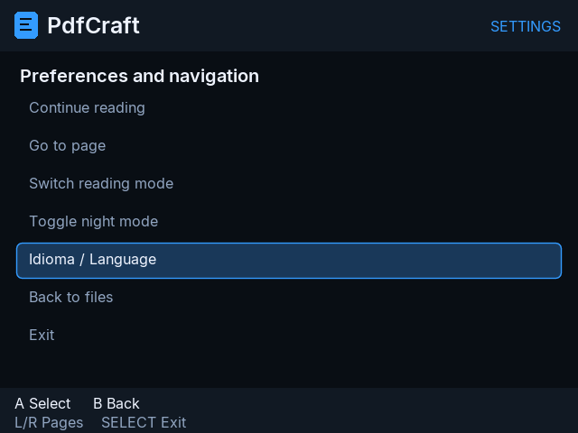

# PdfCraft R36S

PDF reader for the **R36S**, using **PortMaster**, **LÖVE 11.5** and a native ARM64 rendering engine.

**v0.2.2 — Português / English** · Operation on a physical R36S confirmed by the maintainer on **2026-10-20**.

## Screenshots / Capturas

Capturas reais da interface em LÖVE 11.5 no ambiente de teste, em 640 × 480. / Actual UI captures from the LÖVE 11.5 test environment, at 640 × 480.

| Boas-vindas / Welcome | Biblioteca em português |
| --- | --- |
|  |  |

| English library | Reading / Leitura |
| --- | --- |
|  |  |

| Zoom | Night mode / Modo noturno |
| --- | --- |
|  |  |

| Tools / Ferramentas | Settings / Configurações |
| --- | --- |
|  |  |

## Português

Leitor de PDF adaptado para a tela de 640 × 480 e os controles do R36S. O aplicativo é de leitura: não modifica seus PDFs.

### Recursos

- Português e inglês, com escolha de idioma nas boas-vindas da primeira abertura.
- Idioma salvo e alterável no menu.
- A confirma e B volta, inclusive após atualizar configurações antigas.
- Zoom até 32× com renderização da região visível, sem o antigo teto de 2 megapixels da página.
- Navegação pelo direcional ou analógico, tela cheia, modo texto e modo noturno.
- Última página salva, PDFs protegidos por senha, Recentes e Favoritos.

### Instalação

1. Baixe **PdfCraft-R36S-v0.2.2-R36S.zip** na seção Releases.
2. Extraia `PdfCraft.sh` e a pasta `pdfcraft-r36s` dentro da pasta `ports` do cartão.
3. Tenha o PortMaster e o runtime **LÖVE 11.5** instalados.
4. Coloque seus PDFs em `ports/pdfcraft-r36s/documents`.
5. Abra PdfCraft pelo menu Ports e escolha o idioma.

Ao atualizar, substitua os arquivos do aplicativo e preserve seus PDFs e a pasta `pdfcraft-r36s/conf`. Não é necessário apagar as configurações antigas. A tela inicial aparece uma vez quando ainda não há idioma salvo.

### Controles

| Botão | Ação |
| --- | --- |
| A | Confirmar/abrir; na leitura, alternar tela cheia |
| B | Voltar/cancelar; na leitura, voltar à biblioteca |
| Direcional / analógico esquerdo | Navegar ou mover a página |
| L / R | Página anterior / seguinte |
| L2 / R2 | Reduzir / ampliar zoom |
| X | Favorito na biblioteca; modo noturno na leitura |
| Y | Modo texto na leitura |
| START | Menu / ferramentas |
| SELECT | Sair |

Na tela de senha: A digita, X alterna maiúsculas, Y apaga e START abre o arquivo.

Para trocar o idioma: `START > Idioma / Language` na biblioteca; durante a leitura, `START > Mais opções > Idioma / Language`.

### Limitações

- Arquivos de até 128 MB; a complexidade do PDF influencia o desempenho.
- Recentes e Favoritos mostram os arquivos da pasta atual.
- Sem edição, OCR, miniaturas automáticas ou busca textual.
- O modo texto depende de texto selecionável no documento; imagens digitalizadas não são convertidas em texto.
- A renderização por região evita alocar toda a página ampliada, mas não elimina os limites físicos do aparelho.

## English

A read-only PDF reader adapted to the R36S's 640 × 480 display and controls.

### Features

- English and Portuguese, with a one-time welcome language selector and a language menu.
- A confirms and B goes back, including migration from older button settings.
- Up to 32× zoom with viewport rendering at the requested resolution, without the old 2 MP full-page cap.
- D-pad/analog panning, full-screen reading, text mode and night mode.
- Saved reading position, password-protected PDFs, Recents and Favorites.

### Installation

Download **PdfCraft-R36S-v0.2.2-R36S.zip** from Releases. Extract `PdfCraft.sh` and `pdfcraft-r36s` into the SD card's `ports` directory. Install PortMaster and its **LÖVE 11.5** runtime. Put PDFs in `ports/pdfcraft-r36s/documents`, launch from Ports and select your language.

When updating, replace the app files while keeping your PDFs and `pdfcraft-r36s/conf`. Existing settings do not need to be deleted.

### Controls

| Button | Action |
| --- | --- |
| A / B | Confirm / back; A toggles full screen while reading |
| D-pad / left stick | Navigate / pan |
| L / R | Previous / next page |
| L2 / R2 | Zoom out / in |
| X | Favorite in library / night mode while reading |
| Y | Text mode while reading |
| START / SELECT | Menu or tools / exit |

Password screen: A types, X toggles case, Y deletes and START opens the file. Language settings: `START > Idioma / Language` in the library, or `START > More options > Idioma / Language` while reading.

Files are limited to 128 MB. Recents and Favorites are scoped to the current folder. Editing, OCR, automatic thumbnails and text search are not included. Text mode needs selectable text in the PDF. Performance depends on document complexity and available memory.

## Build / Compilar

On Linux with `rustup`, a C compiler and Python 3 available:

```sh
sh build.sh
python3 scripts/package_release.py
```

The build uses Rust 1.99.0, `aarch64-unknown-linux-musl` and Cortex-A35, with a statically linked engine. Internet access is needed to obtain the toolchain and Cargo dependencies on the first build. Output: `dist/PdfCraft-R36S-v0.2.2-R36S.zip`.

The frontend version is **0.2.2**; it retains the **0.2.1** viewport-rendering engine. See [README-R36S.md](README-R36S.md) for implementation details and [RELEASE_NOTES.md](RELEASE_NOTES.md) for this release.

## Validation / Validação

The maintainer confirmed this version works on a physical R36S. Automated checks used LÖVE 11.5 and the ARM64 engine under Cortex-A35 emulation, covering first launch, saved language after restart, both languages, A/B controls, legacy settings migration, password controls and 32× zoom. This is not a claim of compatibility with every firmware or PDF.

## Credits and license / Créditos e licença

R36S adaptation maintained by **Kaio Henrique / kaiaum01**. Based on the PdfCraft engine and the Android source provided for this port. Original copyright notices and upstream attribution are retained in [NOTICE](NOTICE), [ATTRIBUTION.md](ATTRIBUTION.md), [LICENSE-MIT](LICENSE-MIT) and [LICENSE-APACHE](LICENSE-APACHE).

Original code is licensed under MIT OR Apache-2.0. Bundled fonts and dependencies retain their own licenses, included in `port/pdfcraft-r36s/licenses` and the relevant source directories.
